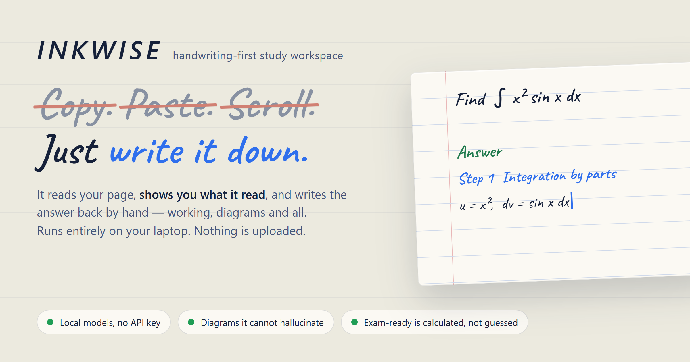
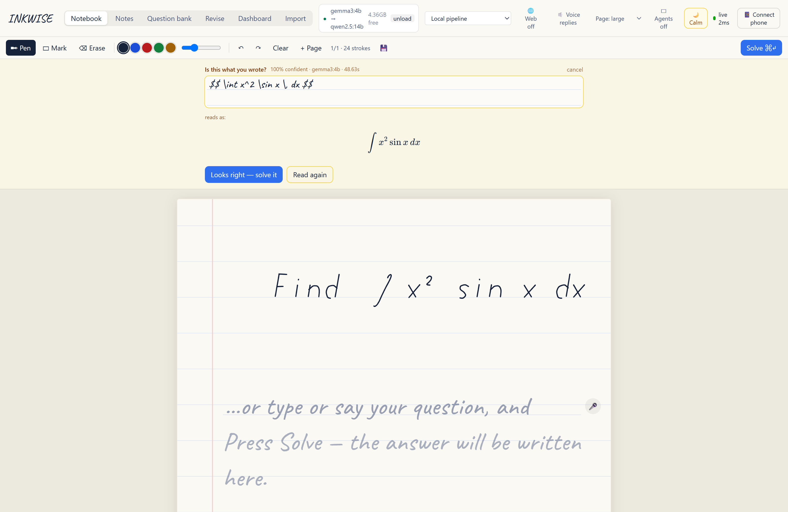
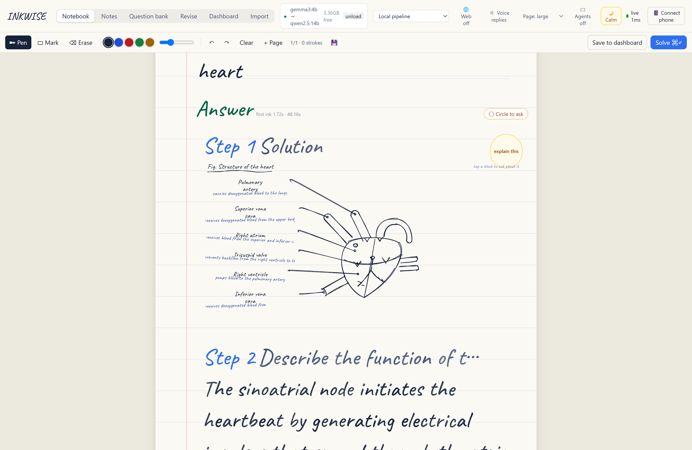
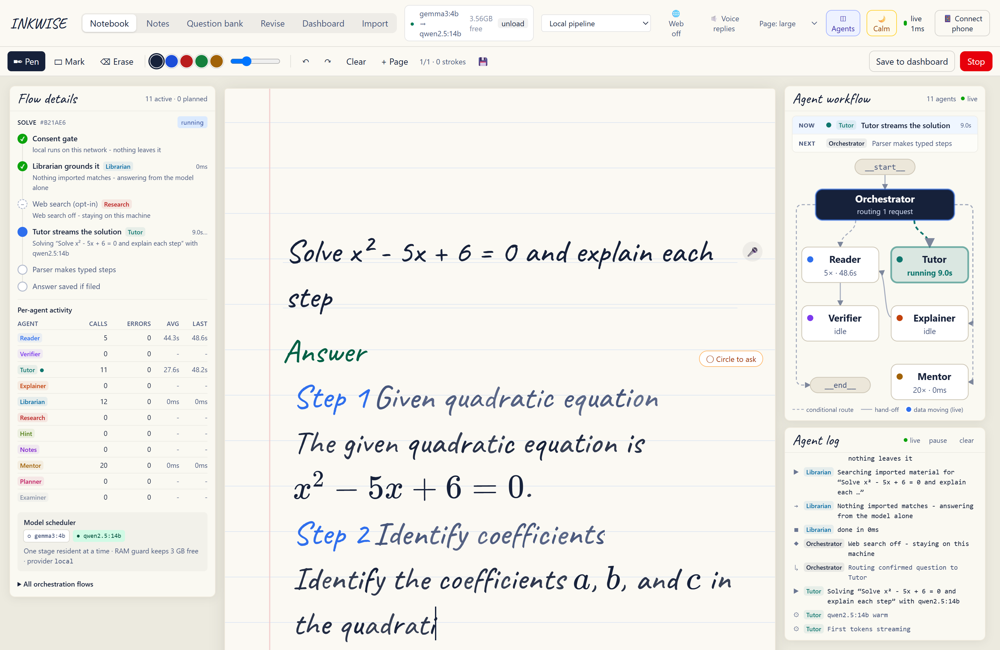

# INKWISE



A local-first handwriting study workspace. Write a question with a stylus, finger
or phone S Pen; the app reads it, solves it, and writes the solution back out by
hand on notebook paper. Progress is tracked deterministically, so "EXAM READY"
means something.

Everything runs on your machine. The cloud provider is optional, off by default,
and never receives anything without an explicit confirmation.

---

## Get it running — one command

With [Ollama](https://ollama.com), [Python 3.11+](https://python.org) and
[Node 18+](https://nodejs.org) installed, paste this into PowerShell:

```powershell
git clone https://github.com/sauravas/INKVERSE.git; cd INKVERSE; ollama pull gemma3:4b; ollama pull qwen2.5:14b; .\start.ps1
```

Then open <http://localhost:8000>.

That one line clones the repo, downloads the two models, creates the Python
virtual environment, installs the backend and frontend dependencies, builds the
frontend, starts Ollama if it is not already up, frees the port if something
else is squatting on it, and serves the app, the API and the pairing socket
together on **:8000**.

**First run takes a while** — about **13 GB** of models to download, plus the
dependency install. After that `.\start.ps1` is a few seconds.

| You need | Why |
|---|---|
| Windows + PowerShell | `start.ps1` is the launcher; the app itself is cross-platform |
| ~16 GB RAM (32 GB comfortable) | the two models hold ~13 GB resident while answering |
| Ollama | runs the local models |
| Python 3.11+, Node 18+ | backend and frontend build |

No API key is needed. Nothing is uploaded. The optional cloud provider is off
unless you turn it on and confirm it.

### Step by step, if you prefer

```powershell
git clone https://github.com/sauravas/INKVERSE.git
cd INKVERSE
ollama pull gemma3:4b       # 3.3 GB - reads your handwriting
ollama pull qwen2.5:14b     # 9.0 GB - solves the question
.\start.ps1                 # builds everything, then serves on :8000
```

For the phone: click **Connect phone** in the top bar and scan the QR with a
phone on the same Wi-Fi. It opens the same workspace — write on either device,
the answer appears on both.

---

## What it looks like

Write the question by hand, and it is read back to you before anything is
solved — the model never acts on a reading you have not confirmed:



Diagrams are drawn from a geometry library that ships with the app. The model
chooses *which* parts to label and what each one does; every coordinate is the
app's, so the anatomy cannot be hallucinated:



Every run is traceable. The agent panels show what ran, in what order, how long
it took and what it decided — including the stages that were skipped and why:



---

## Quick start

```powershell
# one command: frees its ports, starts Ollama if needed, rebuilds the frontend
# if anything changed, then serves app + API + WebSocket
.\start.ps1
```

Open <http://localhost:8000>. For the phone, click **Connect phone** and scan.

There is **one port**, deliberately. Everything - the app, the API and the
pairing socket - is served by FastAPI on :8000, so the address you open is the
address the phone uses, and there is no second build of the app to drift out of
step with the first.

Requirements: Python 3.11+, Node 18+, and [Ollama](https://ollama.com) running
with the two models below already pulled.

```powershell
ollama pull gemma3:4b      # 3.3 GB - reads handwriting
ollama pull qwen2.5:14b    # 9.0 GB - solves the question
```

Dev mode rebuilds `frontend/dist` on every save and reloads the API, still on
the one port:

```powershell
.\start.ps1 -Dev        # same URL, rebuilds on save
.\start.ps1 -Fresh      # force a clean frontend build
.\start.ps1 -Port 9000  # somewhere else
.\start.ps1 -Open       # and open a browser window that behaves
```

### If the screen flickers in fullscreen

Not INKWISE: in fullscreen Chrome hands the display controller one
surface to scan out directly instead of compositing the page, and on
integrated graphics that are also running the model, that path tears.
Windowed is steady. Confirmed on the development machine (Intel Arc
140V) by launching Chrome with `--disable-direct-composition`, which
stops it. `-Open` launches it that way for you. Updating the graphics
driver is the real fix; running the models on the CPU
(`INKWISE_CPU_ONLY=1`) also avoids the contention.

---

## How the AI is wired

INKWISE uses a **two-stage local pipeline** rather than one large model:

```
handwritten page ──> gemma3:4b (vision) ──> question text ──> qwen2.5:14b ──> solution
                      transcribe only                          reason only
```

This was a measured decision, not a preference. The original plan was a single
26B model doing both jobs. Benchmarked on the target machine (Intel Arc 140V,
32 GB shared RAM):

| | gemma4:26b (one model) | gemma3:4b + qwen2.5:14b |
|---|---|---|
| cold load | 219 s | ~15 s + ~40 s |
| one vision read | 270 s total | ~20 s warm |
| resident RAM | 18 GB (4.4 GB free → machine thrashes) | ~12 GB combined |
| handwriting accuracy | better on messy math | good on text, weaker on math |

Full numbers in [`bench/RESULTS.md`](bench/RESULTS.md). gemma4:26b is still
available as an opt-in **"Local high accuracy (slow)"** provider when a question
is worth the wait.

Because the small vision model does misread mathematics sometimes, the
transcription is **always shown for you to correct before solving**. That review
step is not optional polish; it is how the accuracy gap is absorbed.

**Numbers are read twice.** A misread coefficient (`4x^2` seen as `2x^2`) is the
worst failure here: it is invisible in the answer and invalidates every step
after it. Any question containing digits is therefore transcribed a second time,
independently. If the two readings disagree, confidence is capped and *both* are
put in front of you to choose between. This costs a second vision pass; set
`INKWISE_VERIFY_MATH=0` to turn it off.

**Stages are exclusive.** On a 16 GB shared GPU the two models fit individually
but not together — the vision encoder's buffers push it over and the runner is
killed mid-request. INKWISE evicts the other stage before running one, which
trades a model reload for not crashing. Runner crashes are also retried
automatically. See `bench/RESULTS.md`.

### Switching providers

Pick from the dropdown in the top bar, or set `INKWISE_PROVIDER`:

- `local` *(default)* — the two-stage pipeline above.
- `heavy` — gemma4:26b for both stages. Slow, high RAM, better at math.
- `gemini` — Google Gemini. Requires `GEMINI_API_KEY` in the environment, and
  prompts for confirmation before the first upload. Nothing is sent otherwise.

A **RAM guard** refuses to load a model that would leave less than
`INKWISE_MIN_FREE_RAM_GB` (default 3 GB) free, with a message instead of a frozen
laptop. The top bar shows free RAM and an **unload** button.

See [`.env.example`](.env.example) for every setting.

---

## Agents and orchestration

INKWISE runs **five agents**, each with exactly one job. A sixth, the
Examiner, is registered as *planned* and is never called.

| Agent | Job | Backed by | Called when |
|---|---|---|---|
| **Reader** | Transcribe the handwritten page into an editable question | vision model | Solve is pressed; or the Explainer gets a handwritten follow-up |
| **Verifier** | Read the page again, independently, and flag disagreement | vision model | the Reader's question contains digits or maths |
| **Tutor** | Stream a step-by-step solution | text model | the student confirms the question |
| **Explainer** | Explain one selected step, never the whole answer again | text model | the student asks about a step |
| **Mentor** | Exam readiness and the named blockers | rules over SQLite, **no model** | the dashboard opens |
| Examiner *(planned)* | Mark the student's own handwritten attempt | text model | not built yet |

**The orchestrator is code, not a model.** Routing is deterministic: no LLM
decides which agent runs. The orchestrator ([`backend/app/agents.py`](backend/app/agents.py),
called from [`routers/ai.py`](backend/app/routers/ai.py)) owns:

- the **consent gate**: a cloud provider is refused until the student consents
- **blank-page and crop** checks before any model is touched
- **routing and hand-offs**:
  - read = Reader -> Verifier (if digits) -> student review
  - solve = Tutor -> parser -> typed events
  - ask = Reader (if handwritten) -> Explainer
  - dashboard = Mentor
- **model scheduling**, through the provider: one stage resident at a time,
  RAM guard, crash retry

```
Student --> Orchestrator --+--> Reader --(digits)--> Verifier    vision model
 (canvas,   (code: consent, |       ^
  phone)     crop, routing, +--> Tutor                            text model
             scheduling)    +--> Explainer --(handwritten ask)    text model
                            +--> Mentor                           SQLite, rules
                            +..> Examiner (planned)
```

### Live observability

Every request is one **run** (a trace id). Each agent invocation inside it is a
**span**. Runs, spans, routing decisions, model calls (warm or cold),
evictions, retries, RAM-guard blocks and consent blocks are emitted as typed
events by [`backend/app/obs.py`](backend/app/obs.py). The buffer is in memory
and bounded. Events carry only short previews of questions, never images.

| Endpoint | What |
|---|---|
| `GET /api/obs/agents` | agent count, graph edges, the models behind each stage, per-agent call stats |
| `GET /api/obs/stream` | server-sent events: recent buffer replayed, then live |
| `GET /api/obs/recent` | the buffer as JSON |

In the notebook, the empty desk space beside the page shows them:

- **left margin**:
  - the orchestration graph. Nodes pulse while running and edges animate along
    the route taken.
  - a **per-agent activity** table: calls, errors, average and last latency.
    Click an agent for its role, who calls it and its last result.
  - the model scheduler: which model is resident in memory right now.
- **right margin, top**: **Live flow**, the current request step by step. Each
  orchestration step shows done ✓, running ● (with an elapsed timer), skipped
  (with the reason, e.g. "no digits - verification not needed") or failed.
  Click any run header in the log to pin that run here.
- **right margin, bottom**: the live agent log, grouped by run. Click a graph
  node to filter it to one agent.

On a window too narrow for side margins, both open from an **Agents** button
instead.

---

## The three rules this is built on

Spelled out in [`ARCHITECTURE.md`](ARCHITECTURE.md), and enforced:

1. **Writing never waits for AI.** Stroke capture, rendering and phone sync share
   no code path with inference. Kill Ollama mid-session and the notebook keeps
   working; only the Solve button reports an error.
2. **The AI never controls the UI.** The model's raw text stops at the backend,
   which parses it into typed events (`step_open`, `segment{kind:text|math}`)
   streamed over SSE. React decides all layout and animation. Malformed model
   output degrades to a single prose step rather than leaking markup.
3. **Progress is deterministic.** Readiness is computed in
   [`backend/app/readiness.py`](backend/app/readiness.py) — pure functions over
   question rows. The model is never asked whether you are ready.

---

## Features

**Notebook** — pressure-sensitive canvas over Pointer Events, with coalesced-event
capture for full stylus sample rate, velocity-based width when a device reports no
pressure, palm rejection while a pen is in use, stylus-eraser-button support,
highlighter, per-author undo/redo, multiple pages.

**Phone companion** — scan the QR, and the phone becomes a second pen on the *same*
page. The server holds authoritative page state, so a phone joining late receives
the full snapshot. Measured relay latency 0.3 ms, ~25,000 messages/sec locally.

**Reading your handwriting** — the page is cropped to its ink bounding box before
being sent to the model (a typical page shrinks from 1240×1754 to about 594×377),
which cuts prefill cost substantially. Inference is triggered on submit, never per
stroke.

**Handwritten answers, on the page** — the solution is written down the same
ruled sheet, directly below your question, not in a chat panel. Every character
gets a small deterministic wobble in angle, baseline and ink weight, because
uniform glyphs are what make a handwriting font look machine-made. Mathematics
is typeset with KaTeX. The writing animation runs on its own clock and simply
writes faster when the model gets ahead, so inference latency never stutters
the text.

**Ask about one step** — select any step, write or type a follow-up beside it, and
get an explanation of *that step only*. The original question, the full answer and
the selected step go along as context; the answer is not regenerated.

**Dashboard** — subjects → modules → questions, each Pending / Studied / Revised /
Mastered, with important flags and active-recall logging. EXAM READY appears only
when syllabus coverage, important-question mastery and recall accuracy all clear
their thresholds, and every failure is listed as a named blocker.

### Answers are written, not typed out

An answer arrives as steps written in handwriting on the ruled lines, with
mathematics typeset by KaTeX. Where a topic has a shape - an architecture, a
flow, a cycle, the parts of one thing - the tutor draws it, by hand: sketched
boxes, wobbly arrows, handwritten labels, drawn in the order a person would
draw them. Comparisons come out as hand-ruled tables. Everything sits on the
lines: a diagram, a fraction and a table each take a whole number of ruled
lines, so the writing after them lands back on the rule.

Tap a block in a diagram, or circle anything on the page, to ask about it.

### Asking out loud

Tap the microphone and talk. The words appear on the lines as you speak, a
pause ends the question, and it solves itself two seconds later unless you
change it. Answers to spoken questions are read back aloud, with the
mathematics turned into words ("x squared plus or minus the square root of
b squared minus 4ac"); a toggle reads every answer.

Speech is transcribed on this machine by
[whisper-flow](https://github.com/dimastatz/whisper-flow) running as a
sidecar, using its bundled `tiny.en` model. `start.ps1` sets it up on first
run if Python 3.11 or 3.12 is installed; `-NoVoice` skips it, and everything
else still works. Microphones need a secure page, so use
<http://localhost:8000> on the laptop (the phone, on a LAN address, cannot
record).

### Circle to ask, and follow-ups

Press **Circle to ask** and draw a loop around a diagram block, a formula, a
table entry or a few words. INKWISE works out what you enclosed and asks the
tutor about exactly that; the loop stays on the page in red pencil. Each step
also has one-tap asks - *Simpler, please*, *Another method*, *Why this
formula?*, *Common mistakes* - and every answer becomes a thread in the
margin, so a follow-up like "why not the other way round?" knows what was
just said.

### Notes

The **Notes** tab holds one set of prepared notes per module, written from
that module's imported syllabus and its question bank: each topic a section,
with diagrams and tables where they help, ending in the points to remember.

Select words to highlight them or ask about them. Switch on **Write on the
notes** to annotate with a pen, and draw a loop round anything to ask about
it. Explanations appear in the margin beside the section they belong to.
Highlights, ink and questions are all kept.

### Two notebooks

**Notebook** is the free page: write any question, solve it, annotate it.

**Question bank** works through a module one question at a time. *Start module*
and the first question is written onto the page; you answer underneath, by pen or
from your phone. Stuck? **One hint first** - a nudge toward the method, never the
answer. Still stuck? **The worked answer** is written in below, and every step can
be annotated as usual. Press *Done*, say how it went (knew it / needed the hint /
needed the answer - preselected from what you used), and move on. The session
resumes where you left off.

Every attempt is kept: your handwriting, the hint and the answer. Progress moves
by fixed rules, not AI judgement - the first pass makes a question *Studied*,
later passes make it *Revised*, and each finish logs one recall attempt from the
outcome you chose. *Mastered* stays your own call.

### Importing question banks and syllabi

**Import** takes PDF, DOCX, TXT, or a photo/scan of a printed page. Pages with a
text layer are read directly; scanned pages go through **Tesseract** OCR (found
automatically in its usual install folder; set `INKWISE_TESSERACT` otherwise).
The parser proposes modules (`Module 2`, `Unit III: ...`, `Chapter 4`) and
questions (`Q1.`, `1)`, `(a)`, continuation lines, `[5 marks]`), drops
instructions like *"Attempt any two"*, and shows you the result to correct
**before** anything is saved. Re-importing the same paper does not duplicate it.

Tesseract reads printed text, not handwriting, and it loses superscripts: `x^2`
can come out as `x2`. The review step is where you fix that - you can write maths
as `$x^2$`.

Everything imported is indexed (SQLite FTS5, BM25 - no extra model on the GPU),
and answers, hints and step explanations for questions in that subject are
**grounded in your own material**. Each answer shows which module notes it used.

### Sharing your answer book

Each module's **My answers** collects the question, your handwritten answer,
the hint, the worked answer and your margin annotations, in order - your own
answer book, separate from the prepared notes. *Print / PDF* gives a clean
printout.

*Share with friends* makes a read-only link with a QR code for anyone on the same
Wi-Fi, which you can turn off at any time. Not on the same network? *Export file*
gives an `.inkwise.json` they open with *Question bank -> Open a friend's notes*.
Shared notes land in their own subject, labelled *"Shared by ..."*, with progress
starting at zero - a friend's record never counts toward your readiness.

### Web search (off by default)

The **Web** toggle in the top bar looks factual questions up on Wikipedia and
DuckDuckGo before answering, for current information the local model may not
know (it once answered "Who is Virat ..." about a different person entirely). It
asks before it is first turned on, because it sends the question text off this
machine - never your handwriting or notes. Calculations and proofs skip it, since
stripped of their maths they only search for noise. Sources appear as links
under the answer.

---

## Layout

```
backend/app/
  main.py          FastAPI app, WebSocket endpoint, serves the built frontend
  agents.py        the five agents, topology, orchestration flows
  obs.py           observability event bus (runs, spans, model events)
  readiness.py     deterministic progress maths (pure, no I/O)
  ws.py            shared-workspace stroke sync hub
  imaging.py       ink-bbox cropping before vision
  resources.py     RAM guard
  ai/
    registry.py    provider selection
    ollama_provider.py   two-stage local pipeline + model scheduling
    gemini_provider.py   optional cloud provider
    parser.py      model stream -> typed events
    prompts.py
  agents.py        the agents and the code that orchestrates them
  obs.py           traced runs and spans (never raises, never blocks)
  ingest.py        text extraction (PDF/DOCX/images via Tesseract) + parser
  speech.py        relay to the whisperflow voice sidecar
  ai/diagram.py    edge lists -> validated diagram structure
  retrieval.py     FTS5 grounding in imported material
  websearch.py     optional Wikipedia / DuckDuckGo lookup
  routers/         ai, study, notebook, pair, imports, practice, notes, obs
frontend/src/
  lib/ink.js       stroke geometry, pressure, rendering, PNG export
  lib/sync.js      WebSocket client with backoff
  lib/api.js       REST + typed-event streaming
  lib/obs.js       live agent feed (SSE) and derived graph state
  lib/circle.js    what a drawn loop encloses
  lib/speak.js     reading answers aloud, LaTeX -> words
  components/      InkCanvas, AnswerSheet, HandDiagram, HandTable, StepTools,
                   NotesStudy, PracticeView, ImportView, NotesView, MicButton,
                   LinedInput, PenTools, MiniPad, Dashboard, PairPanel,
                   AgentRails (agent graph + log in the page margins)
speech/.venv/      whisperflow sidecar (its own Python; not in git)
bench/             benchmarks and end-to-end tests
```

---

## Tests

With the backend running on :8000:

```powershell
# fast, no model needed
.\.venv\Scripts\python.exe bench\test_parser.py          # stream parser, chunk-boundary safety
.\.venv\Scripts\python.exe bench\test_retry.py           # runner-crash recovery (simulated)
.\.venv\Scripts\python.exe bench\test_gpu_fallback.py    # GPU driver drops the model -> finish on CPU
.\.venv\Scripts\python.exe bench\test_ingest.py          # import parser + Tesseract OCR
.\.venv\Scripts\python.exe bench\test_sync.py            # two clients, one workspace
.\.venv\Scripts\python.exe bench\test_import_api.py      # import -> commit -> retrieve
.\.venv\Scripts\python.exe bench\test_practice_notes.py  # practice, notes, sharing, bundles
.\.venv\Scripts\python.exe bench\seed_demo.py            # readiness rules + demo data
node frontend\phase2-e2e.mjs                             # browser: import -> answer -> share
node frontend\test-strokes.mjs                           # browser: pen strokes reach the server
node frontend\gap-check.mjs                              # browser: answer follows the question
node frontend\wrap-check.mjs                             # browser: words never split across lines
node frontend\blocks-gallery.mjs                         # browser: every diagram kind + a table
node frontend\circle-e2e.mjs                             # browser: circle a block/formula/word
node frontend\latex-check.mjs                            # browser: no raw LaTeX reaches the page
node frontend\import-live.mjs                            # browser: an import reaches a second tab, live
.\.venv\Scripts\python.exe bench	est_agents.py           # orchestration + observability

# need Ollama (slow)
.\.venv\Scripts\python.exe bench\test_pipeline.py        # handwriting -> answer -> explanation
.\.venv\Scripts\python.exe bench\test_hint_live.py       # hint helps without giving it away
.\.venv\Scripts\python.exe bench\test_web_live.py        # web grounding (needs internet)
.\.venv\Scripts\python.exe bench\test_voice_relay.py     # voice: browser -> whisperflow -> text
.\.venv\Scripts\python.exe bench\test_resilience_live.py # recovers from Ollama down / low memory
node frontend\notes-e2e.mjs                              # notes: prepare, highlight, ink, ask
node frontend\voice-e2e.mjs <wav>                        # voice in a real browser
```

---

## Troubleshooting

**Phone cannot open the page.** Both devices must be on the same Wi-Fi, and
Windows Firewall must allow port 8000 on private networks. If the QR shows the
wrong address, set `INKWISE_PUBLIC_HOST` to the right LAN IP.

**"Not enough free memory to load this model."** The RAM guard is doing its job.
Unload from the top bar, close something, or switch to the `local` provider.

**Ollama 500 / connection forcibly closed.** The model runner crashed. Usually a
model being sent a parameter it does not support; INKWISE queries
`/api/show` and only sends `think` to models that advertise it. If it persists,
restart `ollama serve`.

**Maths transcribed wrongly.** Expected sometimes with the 4B vision model. The
double-read catches many cases and will show you both readings; otherwise fix it
in the review box before solving, or switch to the `heavy` provider.

**Import says Tesseract was not found.** It is looked for on PATH and in
`C:\Program Files\Tesseract-OCR`. Install it (the UB Mannheim build), or set
`INKWISE_TESSERACT` to the full path of `tesseract.exe`. Text PDFs, DOCX and TXT
import without it.

**The microphone button says voice is unavailable.** Either the sidecar is not
installed (run `.\start.ps1` once, with Python 3.11 or 3.12 present), or the
page is not a secure context - use <http://localhost:8000>, not the LAN
address. The first voice request takes a few seconds while the model loads.

**An answer says it used the smaller model.** The text model would not have fit
in free memory, so INKWISE answered with the vision model rather than failing.
Close some applications and ask again for the full answer.

**A friend cannot open a share link.** Same rules as the phone: the same Wi-Fi,
and port 8000 allowed through the firewall on private networks. Otherwise send
them the exported file.

**Transcription feels slow (around a minute).** Two things are in play: the
verification pass doubles the vision work, and stage exclusivity means a model
reload between transcribing and solving. Set `INKWISE_VERIFY_MATH=0` and/or
`INKWISE_EXCLUSIVE_MODELS=0` (the latter only if you have spare VRAM).

---

## Not built yet

- Marking handwritten **answers** automatically. Outcomes are self-reported on
  purpose: an AI grade feeding readiness would break the rule that progress is
  deterministic.
- Accounts or cloud sync. Sharing is LAN links and files by design.
